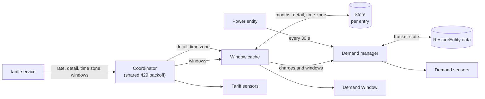
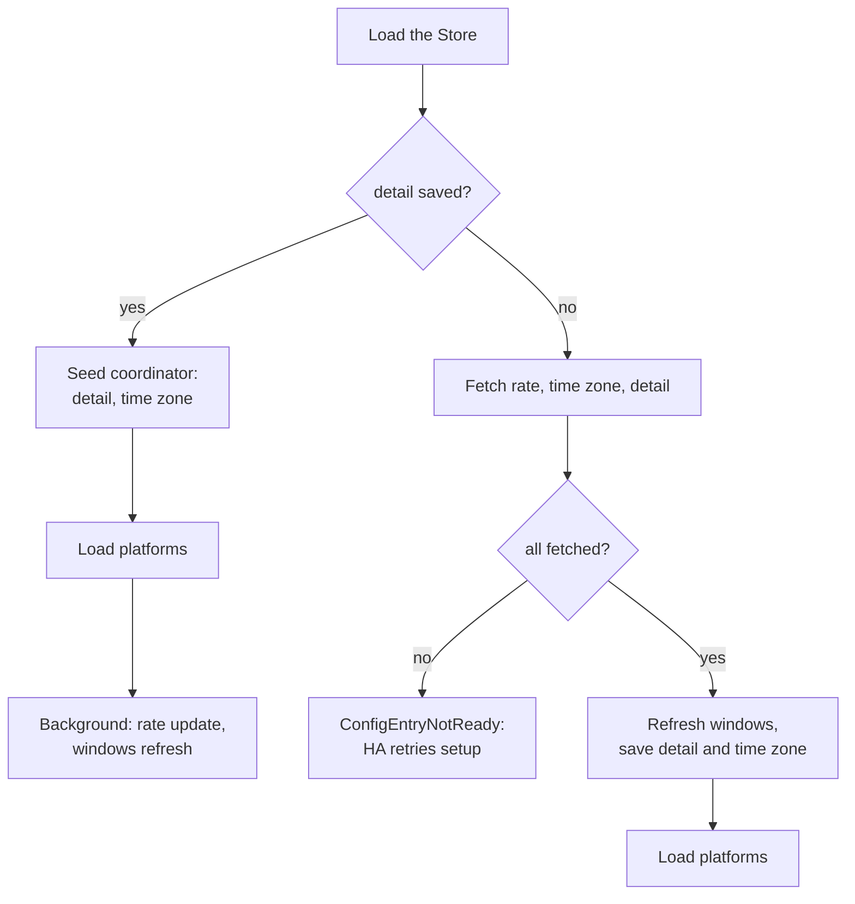
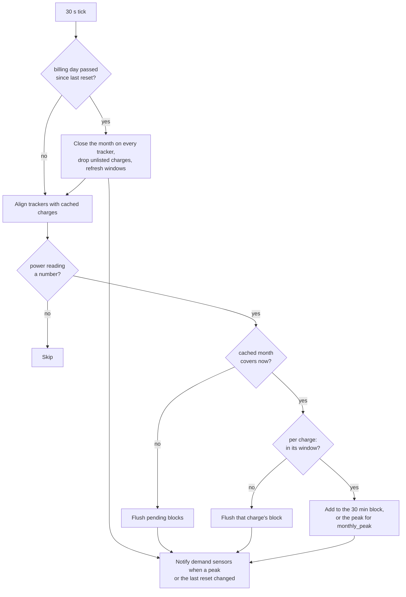
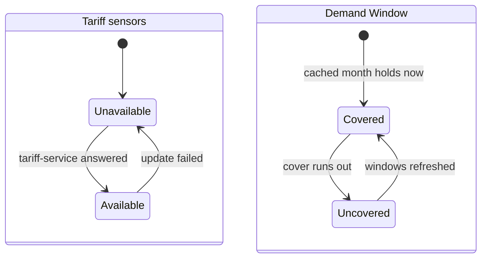

# OEC Tariff integration: design view

Intended design, for human readers. The specs cited below govern.

Drawn from: [functional design §1](../../spec/oec_tariff_au/functional-design.md#1-overview), [§2](../../spec/oec_tariff_au/functional-design.md#2-data-model), [§3](../../spec/oec_tariff_au/functional-design.md#3-business-rules), [§4](../../spec/oec_tariff_au/functional-design.md#4-api-specification)

Checked against `feat/1.4.0` `50dd5a4` on 2026-11-23.

## 1. The integration reads tariff-service and one power entity, and serves sensors

The coordinator is the only client of tariff-service. The window cache keeps what setup and
demand measurement need in the entry's Store
([§2](../../spec/oec_tariff_au/functional-design.md#2-data-model)).

## 2. Setup starts from the Store when it holds a detail

A saved detail means setup sends no request before the sensors load; with none, a failed
fetch has HA retry setup ([rules 3.1 to 3.3](../../spec/oec_tariff_au/functional-design.md#setup-and-refresh)).

## 3. Each sample reaches a charge's peak only inside that charge's window

One 30 s sample, end to end ([rules 3.11 to 3.13](../../spec/oec_tariff_au/functional-design.md#demand-measurement)).

## 4. Availability follows each entity's own source

Tariff sensors depend on tariff-service; Demand Window on the cached months; demand sensors
on neither ([rules 3.16 to 3.18](../../spec/oec_tariff_au/functional-design.md#entities-and-availability)).

