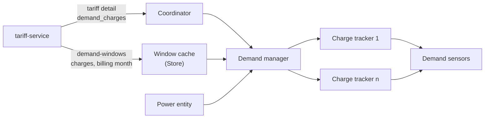

# Per-charge demand tracking from tariff-service windows

- **Issue:** ha-tariff-au #16 (`Advances: PRICE-06`), release `feat/1.3.0`.
- **Depends on:** tariff-service #80 (`feat/0.10.0`), `/calculate/demand-windows` listing each charge's own windows.
- **Status:** awaiting the maintainer's approval.

## Intent

The integration reads tariff-service's single `demand` object and matches windows itself. It therefore gets three things wrong:

- **Seasons.** NASN12 shows its summer rate all year, and its window sensor is inactive from April to November.
- **Clock and holidays.** It ignores `time_basis` (Evoenergy 023 runs on standard time) and public holidays (Ausgrid and Endeavour exclude them).
- **Multiple charges.** It cannot measure more than one charge. SAPN LBAD runs a peak and an anytime charge at once, and Evoenergy 023 has peak and off-peak charges.

tariff-service also plans to remove `demand` once its consumers have moved.

After this change, window logic lives in tariff-service only. The integration measures each charge in the windows the service lists and adds the charges together.

## Goals

- Every demand charge in the tariff detail's `demand_charges` is measured on its own: its windows, its `measurement_method`, its `peak_period`, its rate.
- Windows come from `/calculate/demand-windows` `charges` (tariff-service #80), so seasons, `time_basis`, `days` and public holidays follow the service.
- `peak_period: rolling_12_months` charges bill the highest of the last 12 billing months' peaks. EA302 and Jemena A230 are the kW cases; EA305/310/370/390, MBTOUD and LBAD are kVA.
- Demand Rate, Demand Window, Month Peak Demand, Monthly Demand Charge and Demand Surcharge are right for every seeded demand tariff measured in kW, and follow the same windows and rates for kVA tariffs with kW standing in for kVA.
- The integration no longer reads `demand`.

## Non-goals

- **kVA measurement.** Charges with `unit: kVA` (13 seeded tariffs, LBAD among them) are measured from the kW power entity as a stand-in, as in 1.2.x. True kVA needs an apparent-power input, which is a separate issue.
- **Cumulative charge statistics.** Monthly Demand Charge's long-term `sum` still falls at each billing reset (1.2.4 Validation O1).
- **The billing-day model.** The billing day stays an integration option. A DNSP's own billing cycle is not modelled.

## Anti-goals

- **Window logic in two places.** No local copy of season, day, holiday or clock rules. The local `is_in_demand_window` and its `days` fallback are deleted, not fixed.
- **Counting outside a window.** When the integration has no window list covering now, a charge measures nothing. It never assumes "always in window".
- **Renamed entities.** Unique IDs and entity IDs stay as they are, so history and dashboards survive the update.

## Approaches

| | Windows from | Trade-off |
|---|---|---|
| A | Local rules plus the `holidays` package, with a drift test against the service | Works offline and needs no service change. The window logic exists twice, and the integration gains a dependency. |
| B | `/calculate/demand-windows` merged `windows` | Needs no service change. Overlapping charges are merged (LBAD's anytime peak inside 17:00 to 21:00 is lost), and charges are told apart only by rate. |
| **C (chosen)** | `/calculate/demand-windows` `charges` (tariff-service #80) | Logic lives in one place and every charge keeps its own windows. Needs tariff-service `0.10.0` first. |

The maintainer chose C on 2026-11-17 and planned tariff-service `feat/0.10.0` for #80.

## Design

### Fetching windows

- **Range.** The current billing month, `[billing start, next billing start)`. It is never longer than 31 days, so it is one `/calculate/demand-windows` request with offset datetimes.
- **When.**
  - At setup.
  - At each billing reset, for the new month.
  - Once a day, to pick up a new tariff version.
  - Whenever the cache does not cover the next 24 hours.
- **Rate limits.** Every request goes through the coordinator's session and the shared 429 backoff from #18.
- **Cache.** The last response is kept in a `homeassistant.helpers.storage.Store` per config entry. A restart during a service outage keeps measuring until the cached range ends.
- **No cover.** If the cache does not cover now:
  - trackers measure nothing;
  - Demand Window is unavailable;
  - one warning is logged per outage.
- **No version for part of the range.** The service answers 404 when any date in the range has no tariff version (a billing month crossing 1 July before the next year is seeded). The integration then retries once with the range ending at the next 1 July 00:00 on the DNSP's clock. A second 404 is "no cover" (my call).
- **Older service.** A response without `charges` comes from tariff-service before `0.10.0`. It is treated as "no cover", and the warning names the minimum version.

### Charge identity

A charge is keyed by `(period, months)`. `months` is `null` or a sorted tuple. The key keeps Endeavour's summer and winter `peak` charges apart. It also stays stable when a new tariff version changes a charge's rate or times mid-month. Each `charges` entry from #80 maps to its tracker by the same key; #80's entries carry `months`.

### Charge tracker

`DemandTracker` becomes one tracker per charge key. Sampling, the 30-minute blocks, the flush on shutdown and the restore behaviour stay as they are, with these changes:

- **In window.** A sample counts when `now` lies in one of the charge's cached windows (`start <= now < end`), comparing aware instants. `on_dnsp_clock` and `is_in_demand_window` go.
- **Block method.** `measurement_method` picks the block reduction as today:
  - `30min_avg` is the mean of the block's samples;
  - `30min_max` takes the block's highest sample;
  - `monthly_peak` takes the highest sample on its own, with no blocks.
  - `rolling_12month_max` is reduced like `30min_max`. Rolling is decided by `peak_period`, not by this value.
- **Chargeable peak.**
  - `peak_period: month`: this billing month's peak.
  - `peak_period: rolling_12_months`: the highest of this month and the last 12 rolled-over months.
- **Billing reset.** Every tracker resets on the integration's billing day, as today.
- **Charge.** The month's charge is the chargeable peak times the charge's rate in the latest `charges` entry for its key, so the version in force now. The daily windows refresh keeps it current. A key the cached month does not list takes its rate from the latest tariff detail (my call).
- **Key change mid-month.** A key is dropped when the latest tariff detail's `demand_charges` no longer lists it (a 1 July reform redefining `months`). A dropped key's tracker keeps its peak and its last rate until the billing reset, then is removed. A charge out of season is absent from `charges` but listed in the tariff detail, so it keeps its tracker and its rolling history. The tariff detail is refetched at most once every 24 hours, and a failed refetch keeps the previous detail. A new key starts at zero (my call).
- **kVA.** A `unit: kVA` charge gets a tracker fed by the kW power entity, and its attributes carry `"measured_as": "kW"`. kW never exceeds kVA, so its charge reads low (the maintainer's decision, 2026-11-17).

### Sensors

Entity IDs and unique IDs stay the same. New attributes are added.

| Entity | Value | Change |
|---|---|---|
| Demand Rate | Rate of the in-season charge with the highest rate, kW or kVA. `0.0` when no charge is in season. | Attributes become `charges`: each charge's `period`, `rate`, `unit`, `months`, `start`, `end`, `days`, `public_holidays`, `measurement_method`, `peak_period`. `window_start`, `window_end`, `days` and `season_months` are removed. |
| Demand Window | `active` when any charge's cached window covers now. Transitions are scheduled from the cached window bounds. | Attribute `active_charges`: the periods active now. |
| Month Peak Demand | The highest chargeable peak across charges. | Attribute `charges`: each charge's peak and `demand_recorded_at`. |
| Monthly Demand Charge | Sum over charges of chargeable peak times rate. | Attribute `charges`: each charge's amount. |
| Demand Surcharge | Sum over charges with a peak above 0 of `rate / window hours`, where window hours is that charge's cached window hours in the billing month. | Exact hours replace the 5/7 and 2/7 estimate. |

For a single-charge tariff with no season, the values match today's, except Demand Surcharge, which now uses exact hours.

### Config flow

`_tariff_has_demand_component` reads `demand_charges` and is true when that list is non-empty.

### Upgrade

The restored state from 1.2.x (one tracker) goes to the first charge in `demand_charges` order, kW or kVA, that the cached windows list at restore. When the cache lists none of them, it goes to the first charge in `demand_charges` order. Its saved blob shape stays readable. Other charges start at zero. The CHANGELOG notes the change to Demand Rate's attributes.

## Contract changes

- **Consumed:** tariff-service `/calculate/demand-windows` `charges` (tariff-service #80). The integration requires tariff-service `0.10.0`.
- **No longer consumed:** the tariff detail's `demand` object.
- **Entity attributes (public):**
  - Demand Rate replaces `window_start`, `window_end`, `days` and `season_months` with `charges`;
  - Demand Rate loses its top-level `measurement_method`, which each `charges` entry carries;
  - Month Peak Demand and Monthly Demand Charge gain `charges`;
  - Month Peak Demand loses `demand_window`, `demand_days`, `season_months` and `measurement_method`, and each `charges` entry carries its own `measurement_method` and `peak_period`;
  - Demand Window gains `active_charges`.
- **Unchanged:** entity IDs, unique IDs, units, device and state classes.

## Testing

- One test per seeded shape, with `/calculate/demand-windows` fixtures written by hand from #80's schema. A plan task re-records them from tariff-service `0.10.0` once it is deployed (my call):
  - NASN12: season;
  - Endeavour N72: seasonal pair, holidays excluded;
  - Evoenergy 023: standard time, two charges;
  - EA302 and Jemena A230: rolling 12 months;
  - LBAD: two concurrent kVA charges, each measured from kW with `measured_as: kW`.
- A sample lands in the right tracker at window bounds: start inclusive, end exclusive, across a daylight saving change.
- Window cache:
  - a restart keeps measuring from the Store;
  - no cover means no measurement and Demand Window unavailable;
  - a response without `charges` is treated as no cover.
- The billing reset fetches the new month and rolls every tracker.
- The upgrade moves a 1.2.x blob onto the first charge in season, or the first charge without cover.
- Every test that covers the deleted `is_in_demand_window` is removed or rewritten against cached windows.

## Decisions

- **kVA charges (maintainer, 2026-11-17):** measured from the kW power entity as a stand-in until the kVA issue, marked `measured_as: kW`.
- **#80 entries (maintainer, 2026-11-17):** each `charges` entry carries every `DemandChargeResponse` field (`months`, `start`, `end`, `days`, `public_holidays` among them), so `(period, months)` maps each entry to its tracker. tariff-service #80 is amended to match.

## Calls made in this design

- The windows range is the billing month, cached in a Store.
- A charge is keyed by `(period, months)`.
- Demand Rate shows the highest in-season kW rate.
- Month Peak Demand shows the highest chargeable peak, with a per-charge breakdown in attributes.
- Demand Surcharge uses exact window hours.
- 1.2.x state migrates to the first charge in season.
- On a 404 for part of the billing month, one retry ending at 1 July.
- The rate comes from the latest windows entry, or the latest tariff detail for a charge out of season. A key the latest tariff detail drops bills until the reset.
- Fixtures are hand-written from #80, re-recorded after `0.10.0` deploys.

## Left to the builder

- Whether the per-charge trackers sit inside one manager object or are held in a list by the sensor setup.
- Whether "no cover" raises an HA Repairs issue as well as the log warning.
- The exact daily refresh time.
